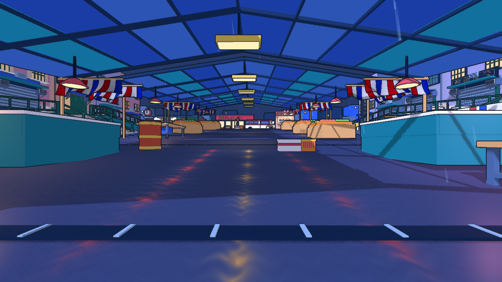

# 雨市光照与材质升级

## 改造前基线

源代码：02a5bc5（此前为分析提交，游戏代码与 88f6940 相同）。保持地图、碰撞、出生点、规则不变，升级光照与表面表现。

- 原生：Apple M5，Godot 4.7.2 Compatibility，3 秒预热、60 秒相机扫描；8 个冻结敌人、雨与狂暴灯正常呈现，无 VSync/FPS 上限。它是可重复渲染负载，不是完整战斗 CPU 基准。
- Web：硬件 Chrome，1280 x 720，60 秒真实回合，固定出生视角持续射击和换弹，最终进入 RESULTS。RAF 统计不是 GPU 耗时，首次加载为本地服务器数据。
- 原生 P95 7.053 ms；Web P95 16.70 ms，P99 16.80 ms。详细条件和最大值见原始 JSON。

[原生数据](before/performance.json) · [Web 数据](before/web-web.json) · [Web 实机](before/web-gameplay.png)

后续实机对比、完整验证和发布记录将追加在这里。
