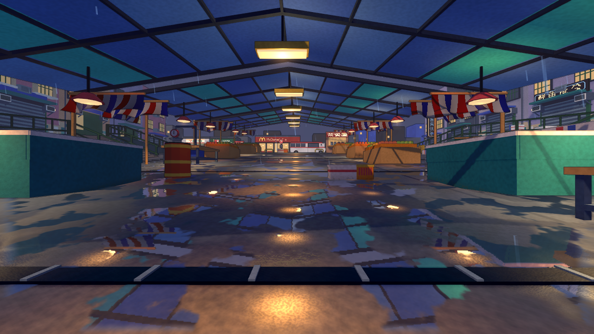

# 雨市光照修正：水洼、反光与顶灯落地

针对上一版实机发灰、湿面反射弱、顶灯在地面缺乏亮斑的问题，重新调整了雨市光色与表面表现。布局、模型轮廓、碰撞、导航、敌人和武器规则不变。

[打开上一版与本次修正的四机位对照](comparison.html)

[原概念图](../../research/fable-rendering-2026-11-11/rain-market-potential.png)仅用于美术方向；上图和对照页来自 Godot 实际渲染。本次仍未达到概念图的几何细节与完整间接光质量，重点处理用户指出的光照和水面差距。

## 调整内容

- 减少均匀补光和雾的提亮，地面由中灰改为偏冷的深色湿路面，保留暖灯与冷棚布的色彩分离。
- 提高局部水洼中的镜面比例，细化水洼遮罩，增强灯具在反射图中的亮度；外围通道降低湿面覆盖，避免整片地面成为镜子。
- 地面分别计算灯下受光区域和随视角变化的粗糙反光，水洼继续显示独立镜像视口的场景倒影。解析灯光用于风格化近似，不是完整物理 GI。
- 根据 `tools/maps/build_rain_market.py` 的实际吊灯行位置校正两侧落光与反光，不再假定两侧灯距相等。
- 减弱地面的细碎法线扰动；提高棚布的冷色表现；新增受深度遮挡的灯具柔光面片，无需全屏 bloom。
- 反射分辨率和刷新上限维持上一版：桌面 640 宽、30 Hz；触屏 384 宽、20 Hz。敌人、武器、雨和非共面地面的反射限制保持不变。

## 原生性能

Apple M5、Godot 4.7.2 Compatibility，1138 x 640 计时视口，3 秒预热、60 秒同轨迹扫描，8 个冻结敌人，雨和狂暴灯运行，关闭 VSync 与 FPS 上限。截图为 1280 x 720。数据包含调度时间，不是独立 GPU 耗时或完整战斗 CPU 基准。

| 指标 | 上一版 | 本次修正 |
|---|---:|---:|
| 平均帧时间 | 7.979 ms | 8.167 ms |
| P95 | 9.260 ms | 9.341 ms |
| P99 | 9.850 ms | 10.052 ms |
| 最大帧间隔 | 27.350 ms | 26.142 ms |
| 平均绘制调用 | 895 | 916 |
| 引擎报告显存 | 151.066 MiB | 151.069 MiB |

这次测得 P95 增加约 0.9%，均值增加约 2.4%，仍有少量长帧；单次采样差异不能当作所有设备的性能保证。

[本次原始数据](after/performance.json) / [上一版原始数据](../rain-market-2026-11-11/after/performance.json)

## 验证与发布

Godot 导入、规则测试、雨市 lookdev 的 headless 与实际渲染检查通过。后者覆盖切图、重开、狂暴灯、反射降档与释放。四机位实机已检查。

Web 通过 1280 x 720、60 秒真实回合（固定视角射击和换弹，进入 RESULTS），P95 16.7 ms、P99 16.8 ms、最大 RAF 间隔 249.9 ms；无脚本和 WebGL 错误。触屏模拟为 844 x 390、15 秒，P95/P99 16.8 ms，无错误。RAF 是浏览器帧间隔，不是 GPU 查询；不将它等同于全程锁帧。

[Web 原始数据](after/web.json) / [Web 实机](after/web-gameplay.png) / [触屏模拟数据](after/touch.json) / [触屏实机](after/touch-gameplay.png)

双站发布与线上验证待记录。未进行人工手感试玩或实体手机验收。
