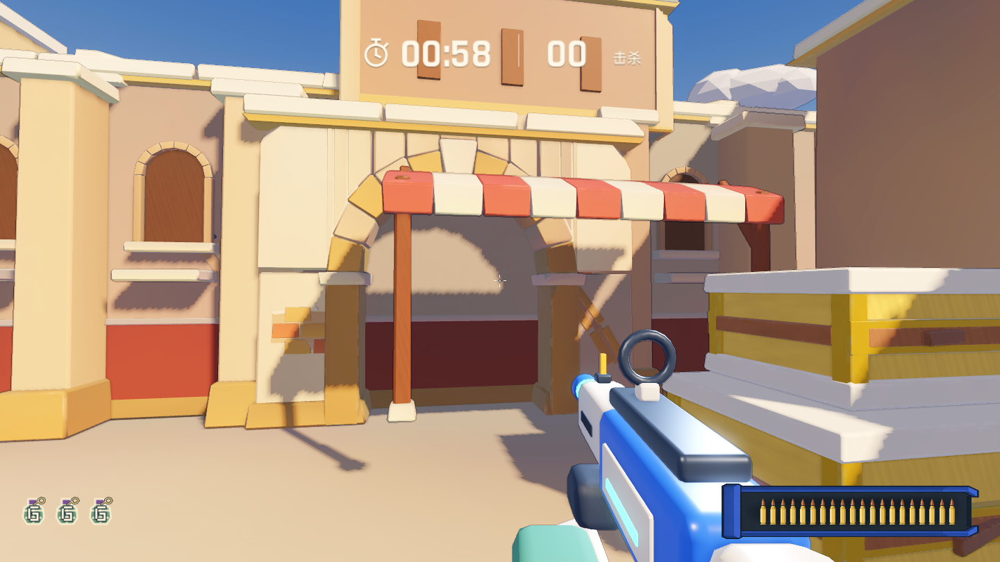
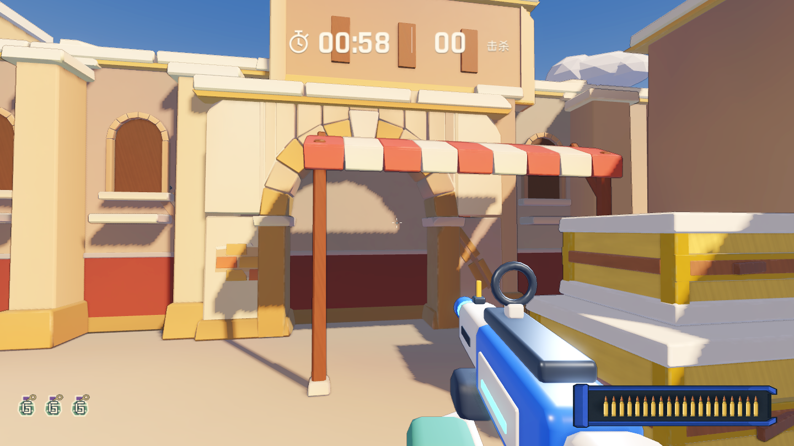

# 沙门遮阳棚支柱落地修正

用户截图中的 A 区高台遮阳棚使用固定 2.02 米支柱；棚顶基准为 5.4 米，前沿偏移为 0.357 米，原柱脚在 3.023 米，而平台地面为 2.4 米，留下 0.623 米间隙。

生成器改为 `post_h = canopy_y - drop * 0.85 - ground_y`，为高台明确指定 `ground_y=2.4`。同时修复共用该生成器的中庭棚和 B 区摊棚，原悬空距离分别为 0.353 米和 0.273 米。两处近景布棚原本已经按地面高度计算，没有修改。

重建可编辑 Blender 源文件，更新 A Long、中庭、B 摊棚及受影响地面烘焙。棚顶、材质色板、碰撞、导航和布局保持原样；其他区域的模型导出变化未纳入修复。

六根相关支柱的 Blender 几何底部均通过坐标校验：高台 2.4 米，其他两处 0 米。Godot 导入、规则检查、沙门首杀/护栏/全路线/60 秒对局/狂暴破坏/重开检查与 Web 导出通过。同机位原生渲染确认柱脚接地、投影连贯；自动检查不代替完整人工试玩。

|修复前|修复后|
|---|---|
|||

## 线上发布

修复提交 `1641bc7` 已推送至 `origin/main`。[GitHub Pages 工作流](https://github.com/YicongCao/No-Art-FPS/actions/runs/43365455657)构建及发布成功，线上 23 个资源通过 manifest 哈希与大小校验。

[正式域名](https://fps.yicong.me/)版本为 `20261113-v2`，保留 `20261113-v1` 回滚。22 个外壳文件、4 个 CDN 文件、压缩/CORS/Range、健康检查及其他站点可访问性验证通过。两个入口均在 Chrome 触控模式下实际加载并进入沙门对局，控制台错误列表为空；Pages 另外完成重开及开火操作。浏览器冒烟不等于真机手机验收。

来源构建保持干净，后续记录提交只增加发布证据，不改变游戏资源。回滚可在 server-connect 项目执行 `python3 scripts/publish_fps.py activate 20261113-v1`，随后校验旧版本健康。
