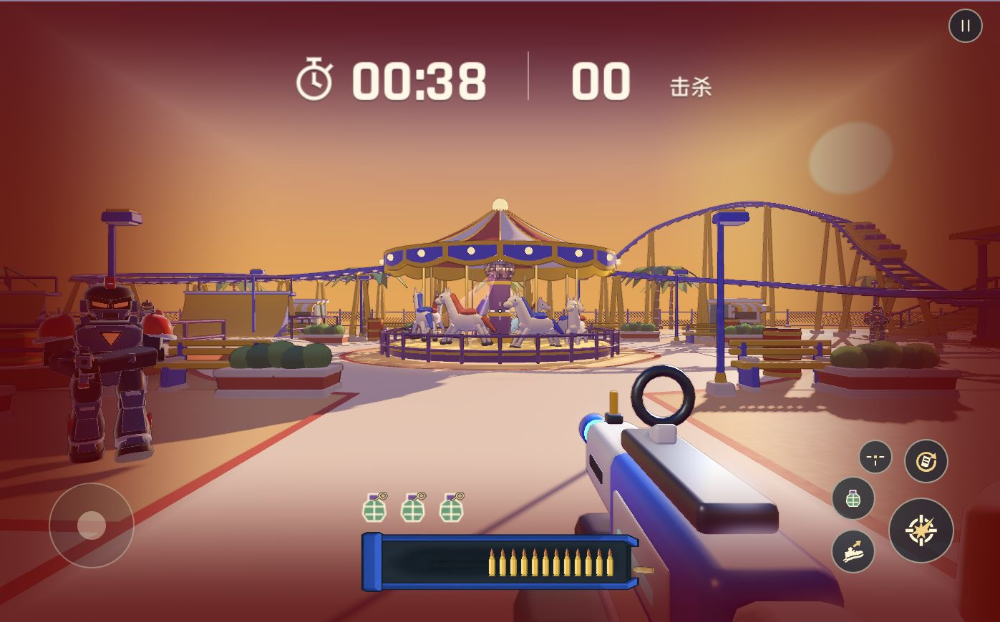

# toy 合入主分支并发布 Web

仓库默认主分支为 `main`，没有 `master`。将 `origin/toy` 的 `ded096f` 完整合入 `main`，合并提交为 `9df8ba0fe72c68edd49daf8a3963cf7f1cf01194`，保留两个分支历史，没有冲突。`toy` 分支保留。运行时代码与已验证的 toy 一致，主分支此前单独移植的敌人瞄准概率调整也保留。

本次上线包含 toy 的玩具材质与角色、地图建模及表面细节、身体战损、最新爆头击杀反馈等累计改动。

## 验证

- Godot 4.7.2 全工程导入、Web release 导出及资源包检查通过。导出排除了设计文档、原始模型、测试与验收截图。
- 规则、移动端输入桥接测试通过。
- 真实射击爆头回归通过，包括两兵种满血/受伤后爆头、暂停、重开、回收、重复计分防护、特效上限及减少动态效果模式。
- 战斗回归通过，包括爆桶、刀兵与两兵种身体战损。
- 敌人命中率检查通过：4000 发样本的瞄准比例为 29.3%；故意打偏的 2830 发均清空碰撞体并经过近失范围。可见近失、掠过声及命中扣血通过。
- 本地 Chrome Web 触控模式实际开局、开火并完成击杀。
- GitHub Pages 线上触控模式实际进入新版游乐场、计时推进与开火，控制台错误列表为空；23 个资源下载后与线上 manifest 的 SHA-256 和大小匹配。

自动化 Chrome 后台标签页的桌面鼠标锁定出现 `WrongDocumentError`，游戏正确进入暂停；本次浏览器玩法验收使用无需鼠标锁定的触控入口。不能将其描述为完整桌面鼠标锁定验收，也未做真机手机或所有地图的完整手感与性能验收。

历史 toy 日志中已有的末尾空行/日志尾空格随合并保留；运行时代码的 whitespace 检查通过。

## 发布

- [GitHub Pages](https://yicongcao.github.io/No-Art-FPS/)
- [正式域名](https://fps.yicong.me/)
- [Pages 成功发布任务](https://github.com/YicongCao/No-Art-FPS/actions/runs/43358967338)

Pages 的 build 与 deploy 均成功，来源为合并提交。正式域名使用同一提交的干净本地构建，版本 `20261113-v1`；旧版 `20261112-v1` 保留，CDN 资源不可变。云端资源、压缩、CORS、Range 206 及私有源站检查通过；切换时服务健康检查通过，其他站点仍可访问。

正式域名线上 Chrome 触控模式进入货场并完成开火，控制台错误列表为空。22 个外壳文件、4 个 CDN 文件、健康检查、Brotli 跳转、Range、404 及其他站点可访问性检查均通过，详情见 `custom-domain-http.json` 与 `browser-check.json`。发布记录提交只新增文档与证据，两个站点的游戏运行版本仍为 `9df8ba0`。

回滚：在本地 server-connect 项目执行 `python3 scripts/publish_fps.py activate 20261112-v1`，再运行该版本的 `verify_fps.py`。GitHub Pages 可从合并前主分支的保留历史恢复并重新部署，不需要 force-push。

Pages 使用 Linux 导出，正式域名使用本地 macOS 导出；各自验证自己的资源 manifest，不要求跨平台 PCK 二进制逐字节一致。

