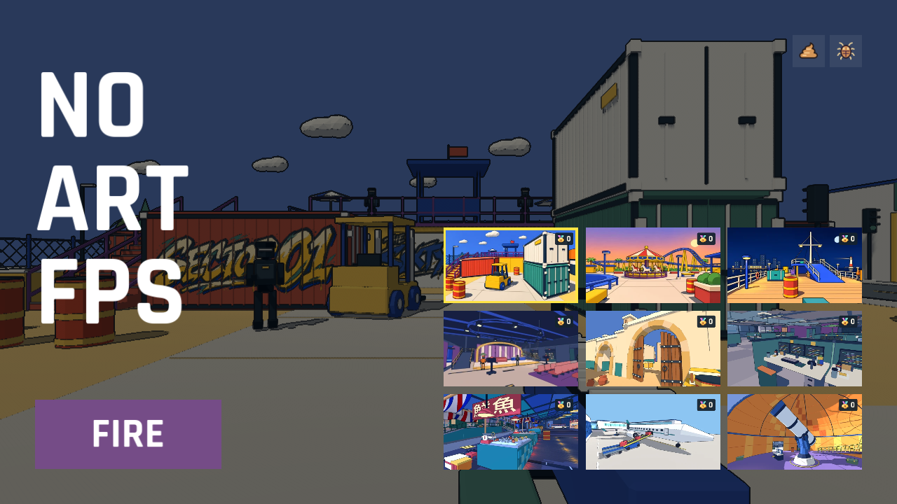

# No-Art-FPS v0.3.0

- **Nine arenas.** Night Studio, Sandgate, BB Office, Hong Kong Rain Market, Baggage Below, and Snowline Observatory join the 60-second score attack. Each new arena has its own soundtrack with a frenzy variation.
- **Three grenades per round.** Throw with **G** or the touch button. In the last 15 seconds, break through walls and stairs and respawn in 1.25 seconds.
- **Fifteen achievements.** Earn pixel badges, chase a separate high score on each map, or play Poop Mode and Cockroach Mode with toy weapons and explosive portable toilets.
- **Mobile and language.** Adjust touch control spacing, calibrate gyro aim in landscape, and switch between Chinese and English.

**Windows x64** — Extract the ZIP and launch `No-Art-FPS.exe` with `No-Art-FPS.pck` in the same folder.

**macOS Universal** — Extract the ZIP and open `No-Art-FPS.app`. It supports Apple silicon and Intel and is signed ad hoc without Apple notarization.

`SHA256SUMS.txt` contains the checksums for both ZIPs.
