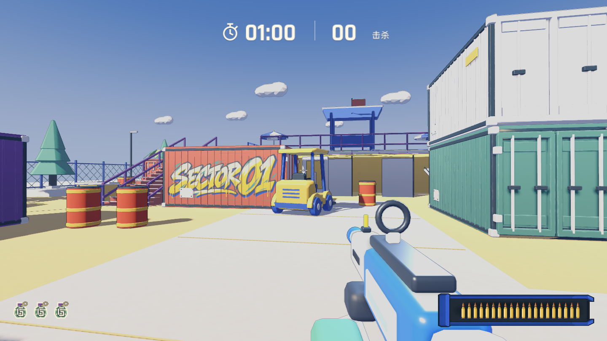
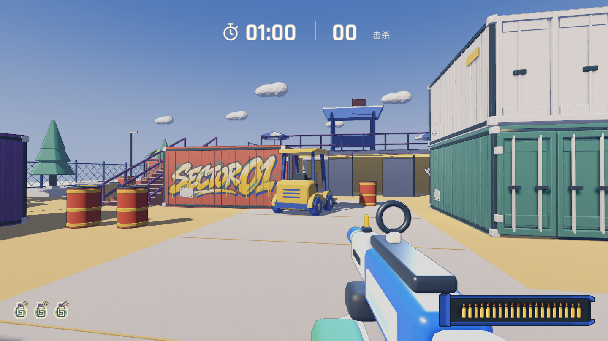
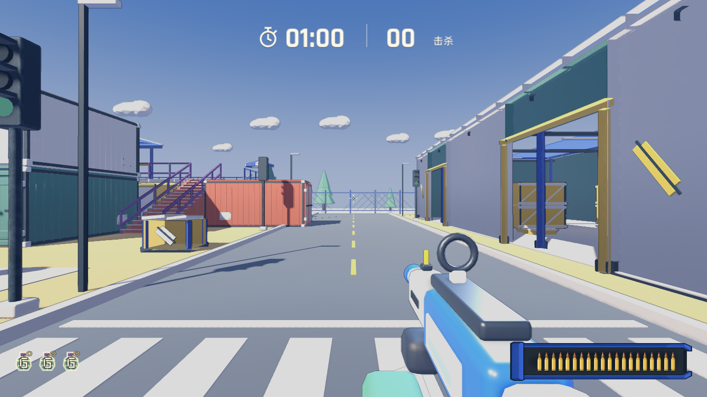
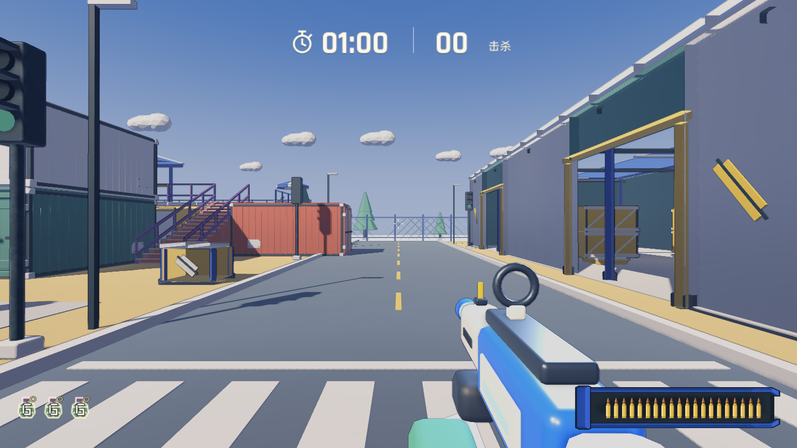
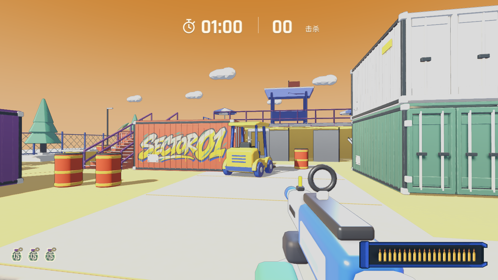
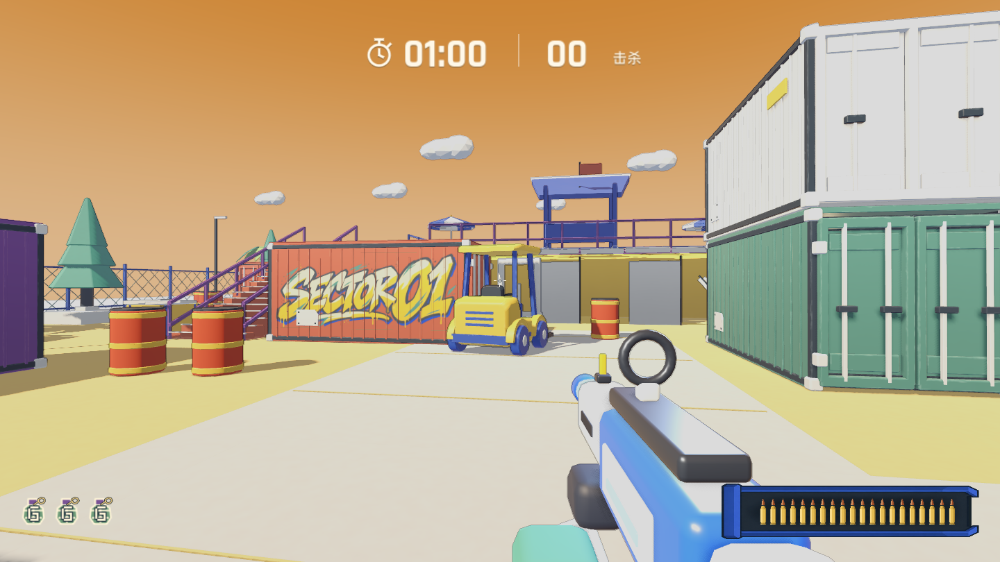
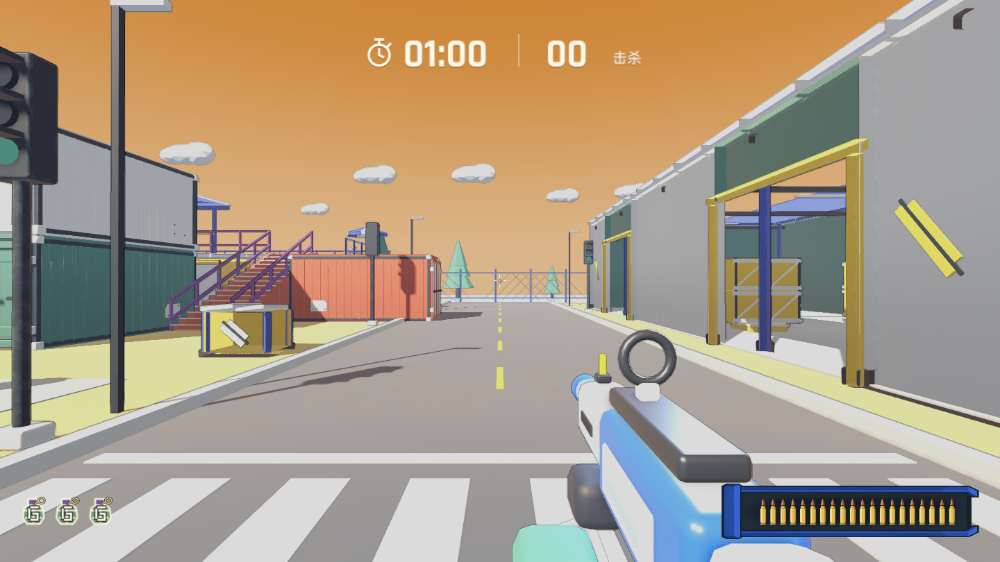
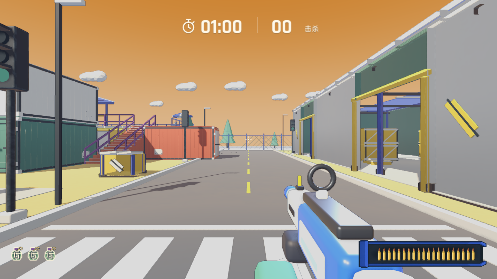

# 堆货场日间光照调整

堆货场浅色货柜、混凝土地面和黄色道具的亮面接近，观感泛白。只调整 `toy_palette.gd` 中 yard 的太阳光与环境光强度，保留材质原色、蓝天、光照方向和其他地图配置。

| 参数 | 调整前 | 调整后 |
| --- | ---: | ---: |
| 太阳光强度 | 0.95 | 0.58 |
| 日间环境光强度 | 0.55 | 0.32 |

## 同机位实机对比

Godot 4.7.2 / Compatibility / Apple M5，1440 × 810。脚本固定相机、关闭敌人和玩家移动，分别采集普通和狂暴状态。图片直接来自游戏渲染，没有调色。

| 视角 | 调整前 | 调整后 |
| --- | --- | --- |
| 货柜与叉车 |  |  |
| 仓库通道 |  |  |
| 狂暴状态货柜 |  |  |
| 狂暴状态通道 |  |  |

浅色地面、红色货柜的亮度下降，黄色区域恢复较暖的色彩层次。天空样本区域保持一致。白色货柜仍表现为浅色涂层，没有通过修改材质将其涂灰。狂暴模式继续保留橙色天空和原有环境补光；太阳光使用调整后的强度。

## 验证

- `python3 tools/qa_run.py --script tools/maps/capture_yard_lighting.gd -- after`：两个机位、两种模式渲染通过；返回普通模式后太阳光 0.58、环境光 0.32。
- `python3 tools/qa_run.py --headless --script tests/rules_test.gd`：规则检查通过。
- `./tools/export_web.sh`：Godot 导入、Web 导出与资源验证通过，23 个 Web 文件、1072 个打包资源。
- 仅修改两个光照强度，不添加灯光、后处理或着色器开销；本轮未做帧时间基准测试。
- 线上发布和浏览器启动证据另见发布记录。
