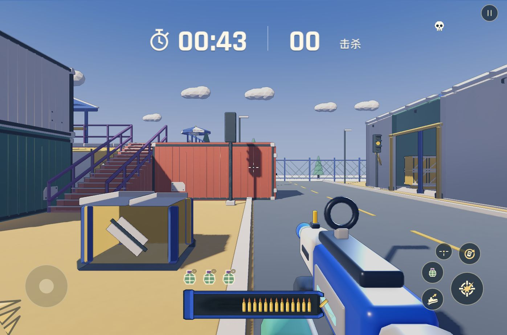
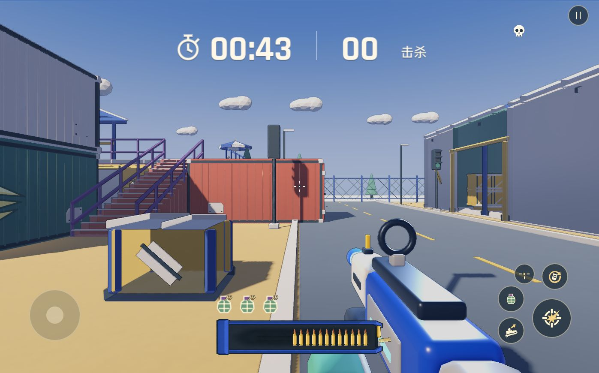

# 堆货场光照发布记录

- 游戏修改：`6c2e097feaf0d6bcf5c86c88bd957f03feade531`，已推送 `origin/main`。
- GitHub Pages：[部署任务 43368145589](https://github.com/YicongCao/No-Art-FPS/actions/runs/43368145589)，构建与部署成功；线上 23 个文件按该站点 manifest 校验大小与 SHA-256。
- 自定义域名：`20261113-v3`；回退版本保留为 `20261113-v2`。22 个站点文件与 4 个 CDN 资源校验通过，healthz 确认新版；Brotli、CORS、Range、缺失文件 404 和私有源站限制检查通过。
- 导出快照的运行时代码对应上述提交；快照时只有自动生成的截图工具 `.gd.uid` 未跟踪，它位于导出排除的 `tools/` 下，随本记录纳入版本控制。

## 浏览器验证

Chrome 分别打开两个公开地址的 `?touch=1` 模式，选择堆货场、点击 FIRE、进入对局并按住射击。确认地图渲染、倒计时推进及弹药消耗；两个页面捕获到的 error 日志均为空。

这是桌面浏览器自动化触控模式验证，不代表物理手机、陀螺仪或完整人工游玩测试。同机位光照对比见 [调整记录](README.md)。

| GitHub Pages 实机 | 自定义域名实机 |
| --- | --- |
|  |  |

证据：[Pages 资源校验](pages-verification.json)、[浏览器检查](browser-verification.json)、[自定义域名校验](custom-verification.json)。
